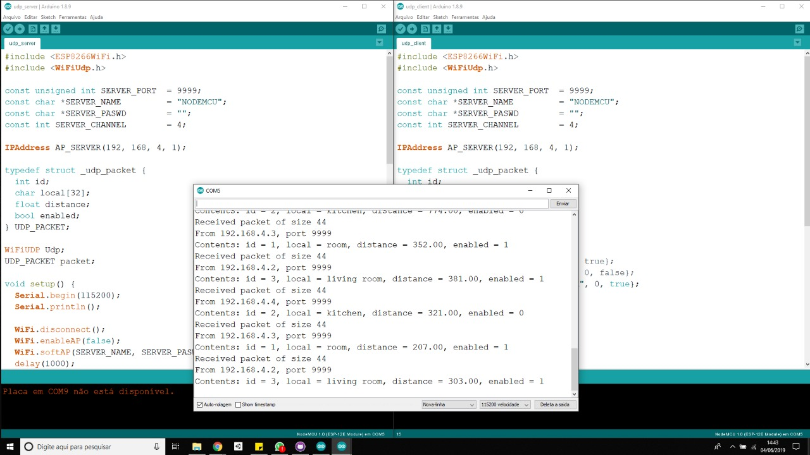
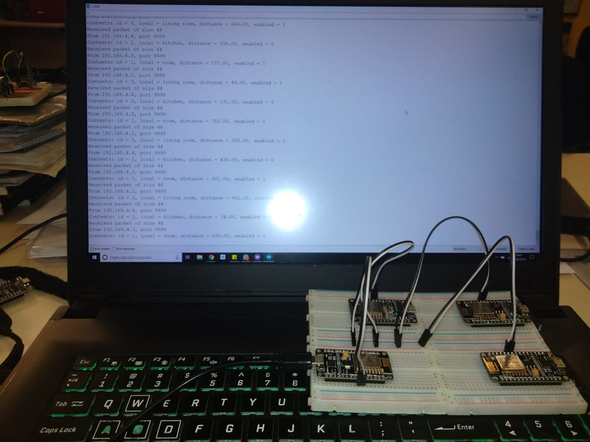

# NodeMCU UDP Multiclient

[](https://github.com/kleberandrade/nodemcu-udp-multiclient/actions/workflows/ci.yml?query=branch%3Amaster)
[](src/main.cpp)
[](examples/udp_demo.py)
[](requirements.txt)
[](platformio.ini)
[](platformio.ini)
[](https://docs.platformio.org/en/latest/boards/espressif8266/nodemcuv2.html)
[](LICENSE)

A small Arduino C++ example for **NodeMCU ESP8266**: one board creates a Wi-Fi
access point and receives telemetry from several station clients over UDP.
Clients send an ID, location, simulated distance, and enabled flag once per second.
No router, sensor, cloud service, or ESP32 is required.

The original 2017–2019 project is by Kleber de Oliveira Andrade. This update keeps
the AP/server and station/client design, fixes the broken server sketch, and adds
an explicit wire format, a pinned build, host examples, and automated tests.

## Requirements

- One NodeMCU 1.0 ESP-12E/ESP-12F development board (4 MB flash) for the server,
  plus one or more identical ESP8266 boards for clients.
- USB **data** cables and stable USB power for each board. No external wiring is
  needed; no GPIO pins or onboard LED are used. Distance is generated with
  `random(0, 1000)` and has no physical unit or sensor accuracy.
- Python **3.11–3.13** (3.13 validated), pip, and Git. Tests also require Clang or
  GCC with AddressSanitizer/UndefinedBehaviorSanitizer (macOS/Linux).
- Internet access for initial tool installation. Subsequent builds use the local
  `.pio/` cache. On Apple Silicon, the Xtensa compiler provided by PlatformIO
  runs through Rosetta 2; install Apple's Rosetta support if macOS prompts for it.
- A USB serial driver appropriate to the board's CH340 or CP210x bridge, if the
  operating system does not detect it automatically.

The canonical build uses PlatformIO Core **6.2.0**, Espressif8266 platform
**4.2.1**, Arduino ESP8266 core **3.1.2**, and Xtensa GCC **10.3.0**.
The framework, compiler, and upload packages are pinned in `platformio.ini`.
`ESP8266WiFi` and `WiFiUDP` come with the core; no external Arduino libraries are
needed. These are the stable ESP8266 platform/core releases available when this
upgrade was prepared; they do not imply a vendor support lifetime.

## Install and build

From a terminal with a supported Python interpreter (`python3.13` can be used in
place of `python3`):

```sh
git clone https://github.com/kleberandrade/nodemcu-udp-multiclient.git
cd nodemcu-udp-multiclient
python3 -m venv .venv
. .venv/bin/activate
python -m pip install -r requirements.txt
pio run
```

`pio run` builds the server and default client, without uploading anything.
Outputs are `.pio/build/server/firmware.bin` and
`.pio/build/client/firmware.bin`. On Windows, activate with
`.venv\Scripts\Activate.ps1`; firmware builds are supported, but the sanitizer
host tests documented here target macOS/Linux.

## Configure Wi-Fi and client identity

```sh
cp include/config.local.h.example include/config.local.h
```

Edit that ignored file before building. Every board needs the same SSID and
password. The default network is `NODEMCU`, password `nodemcu-demo`; this is a
public demonstration password, so replace it for your own setup. An empty
`WIFI_PASSWORD` explicitly creates an open network. Supported passwords are
8–63 bytes. SSIDs are 1–32 bytes.

Client identity is selected by build environment: `client` sends ID 1,
`client2` sends ID 2, and `client3` sends ID 3. Do not define `CLIENT_ID` in the
local header when using these environments. To add another identity, copy an
environment and set `-DCLIENT_ID=4` in its `build_flags`.
`CLIENT_LOCATION` is an optional printable ASCII label of at most 31 bytes,
for example `"kitchen"`. Give each physical client a distinct nonzero ID;
the server logs IDs but does not register or authenticate them.

Shared constants in `include/config.h` select UDP port **9999**, Wi-Fi channel
**4**, up to **4 stations**, and a **1000 ms** send interval. A laptop connected
to the AP also consumes a station slot. The server explicitly uses
`192.168.4.1/24`; clients send to their DHCP gateway.

## Upload and run multiple clients

List serial devices and replace each example port with a real device:

```sh
pio device list
# Server board
pio run -e server -t upload --upload-port /dev/cu.usbserial-SERVER
pio device monitor --port /dev/cu.usbserial-SERVER --baud 115200
```

In another terminal, with the virtual environment activated, upload clients to
separate boards:

```sh
pio run -e client -t upload --upload-port /dev/cu.usbserial-CLIENT1
pio run -e client2 -t upload --upload-port /dev/cu.usbserial-CLIENT2
pio run -e client3 -t upload --upload-port /dev/cu.usbserial-CLIENT3
```

Linux ports usually look like `/dev/ttyUSB0`; Windows uses names like `COM3`.
Close any monitor using a port before uploading to that board. Start the server
first. Client connection attempts do not block `setup()`; the core's automatic
reconnection remains enabled and the socket is reopened after a connection loss.

Expected server output (illustrative, not a recorded hardware test):

```text
AP NODEMCU at 192.168.4.1; UDP 9999: ready
192.168.4.2:9999 id=1 local=living room distance=123.00 enabled=true
192.168.4.3:9999 id=2 local=living room distance=456.00 enabled=true
```

The server processes datagrams as they arrive and prints sender IP/port and fields.
It rejects wrong lengths, unsupported versions, invalid flags, unsafe labels, and
nonfinite/negative distances. It sends no reply. Client `Sent` output means the
local UDP stack accepted the datagram; it does not prove delivery.

## Executable host examples

The Python example uses only the standard library and the same binary format.
Run a finite three-endpoint demonstration without Wi-Fi or boards:

```sh
python examples/udp_demo.py demo
```

For two-terminal testing on your computer:

```sh
# Terminal 1
python examples/udp_demo.py receive --bind 127.0.0.1 --count 3
# Terminal 2
python examples/udp_demo.py send --host 127.0.0.1 --id 1 --local room
python examples/udp_demo.py send --host 127.0.0.1 --id 2 --local kitchen --disabled
python examples/udp_demo.py send --host 127.0.0.1 --id 3 --distance 123.5
```

To send to a physical server, connect your computer to the `NODEMCU` Wi-Fi network
and run `python examples/udp_demo.py send --id 100 --local laptop`.
`--count N` sends N datagrams immediately, so use small values for the board's
serial logger. `receive` listens until interrupted unless `--count` is supplied;
its count includes only valid packets. See `--help` on each subcommand.

## Protocol and API

See [the wire format and codec API](docs/protocol.md) for byte offsets, validation,
and a shared C++/Python test vector. The C++ `Packet` retains the original fields
`id`, `local`, `distance`, and `enabled`, but only explicit encoding may be sent.

UDP provides no delivery, ordering, deduplication, retry, or acknowledgement
guarantee. The example adds no sequence numbers or reliability layer. The AP has
no Internet uplink, and packets have no application authentication or encryption.
Wi-Fi credentials control network access but cannot establish the authenticity
of a claimed client ID. Use this as a trusted local demonstration, and design a
reliability/security layer before using the telemetry for consequential actions.

## Tests

```sh
python -m unittest discover -s tests -v
pio run -e server -e client -e client2 -e client3
python examples/udp_demo.py demo
```

The seven automated tests compile the **actual firmware codec** with C++11,
`-Wall -Wextra -Werror`, AddressSanitizer and UndefinedBehaviorSanitizer. They
exercise a fixed wire vector in both languages, float/ID/label boundaries,
malformed datagrams, deterministic randomized interoperability, three UDP source
endpoints, and reception after an invalid packet. `CXX=clang++` or `CXX=g++`
selects the host compiler. CI runs these tests, the demo, and all four builds.

Builds and host tests do **not** validate flashing, Wi-Fi association, radio loss,
reconnection on a physical board, power stability, or simultaneous physical
stations. See [validation and a hardware checklist](docs/validation.md).

## Migration from the original sketches

- Install PlatformIO and build from the repository root. The `.ino` entry points
  are retained in their original folders and included by `src/main.cpp`; opening
  a sketch alone in Arduino IDE no longer supplies all shared include paths.
- Move `SERVER_NAME` / `SERVER_PASWD` settings to `WIFI_SSID` / `WIFI_PASSWORD`
  in `include/config.local.h`. The formerly open default AP now has a demo password.
- Reflash **both server and every client together**. The former raw `UDP_PACKET`
  memory layout is incompatible with version 1's 46-byte network format. There
  is no legacy decoder; raw struct transfers could depend on padding, native
  integer sizes, byte order, and unterminated strings.
- Replace direct `Udp.write((byte*)&packet, sizeof(packet))` calls with
  `protocol::encode`; decode and validate before reading fields on the server.
- The undefined `incomingPacket` write has been removed. No null terminator is
  written past the end of a binary packet.

## Troubleshooting

- **No serial port / upload timeout:** use a data cable, verify the USB bridge
  driver, close serial monitors, select the correct port, and try another cable.
  If automatic reset fails, hold FLASH while starting upload, then release it.
- **No readable logs:** set monitor speed to 115200. The ESP8266 ROM boot message
  uses a different baud rate; subsequent application messages use 115200.
- **Client waits forever:** check matching credentials, server power and logs,
  2.4 GHz reception, and available AP station slots. Reset the client after
  fixing configuration; follow the hardware checklist for reconnection testing.
- **No packets:** verify the computer joined the AP, disable VPN routes that
  capture `192.168.4.0/24`, and allow local UDP port 9999 through the firewall.
  Do not expose or forward this demo port to the Internet.
- **Rejected packets:** upgrade all endpoints together and use the included
  codec; text strings and legacy structs are not version 1 datagrams.
- **Build tool cannot run on Apple Silicon:** check Rosetta availability. Python
  3.13 may print `SyntaxWarning: invalid escape sequence` from upstream core
  `elf2bin.py`; this did not prevent generation of firmware in the validated build.
- **Host socket test gets `Operation not permitted`:** allow localhost networking
  in the execution environment. That failure is not evidence of a codec defect.

## Original demonstration

The original photos and video are retained as historical context; they predate
the version 1 protocol and current configuration.




[Watch the original video](https://www.youtube.com/watch?v=j2EpkgpPG8g).

## References and license

- [PlatformIO NodeMCU 1.0 board documentation](https://docs.platformio.org/en/latest/boards/espressif8266/nodemcuv2.html)
- [Espressif8266 platform 4.2.1 release](https://github.com/platformio/platform-espressif8266/releases/tag/v4.2.1)
- [Arduino ESP8266 3.1.2 documentation](https://arduino-esp8266.readthedocs.io/en/3.1.2/)
- [SoftAP configuration and station limits](https://arduino-esp8266.readthedocs.io/en/3.1.2/esp8266wifi/soft-access-point-class.html)

[MIT License](LICENSE), copyright (c) 2019 Kléber de Oliveira Andrade.
The original README also credited Copyright 2017–2019 Kleber de Oliveira Andrade;
that attribution is preserved here. External framework and toolchain components
keep their own licenses; see [third-party notices](THIRD_PARTY_NOTICES.md).
